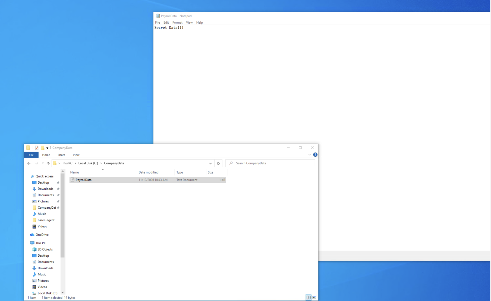
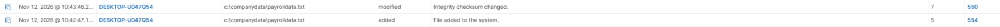
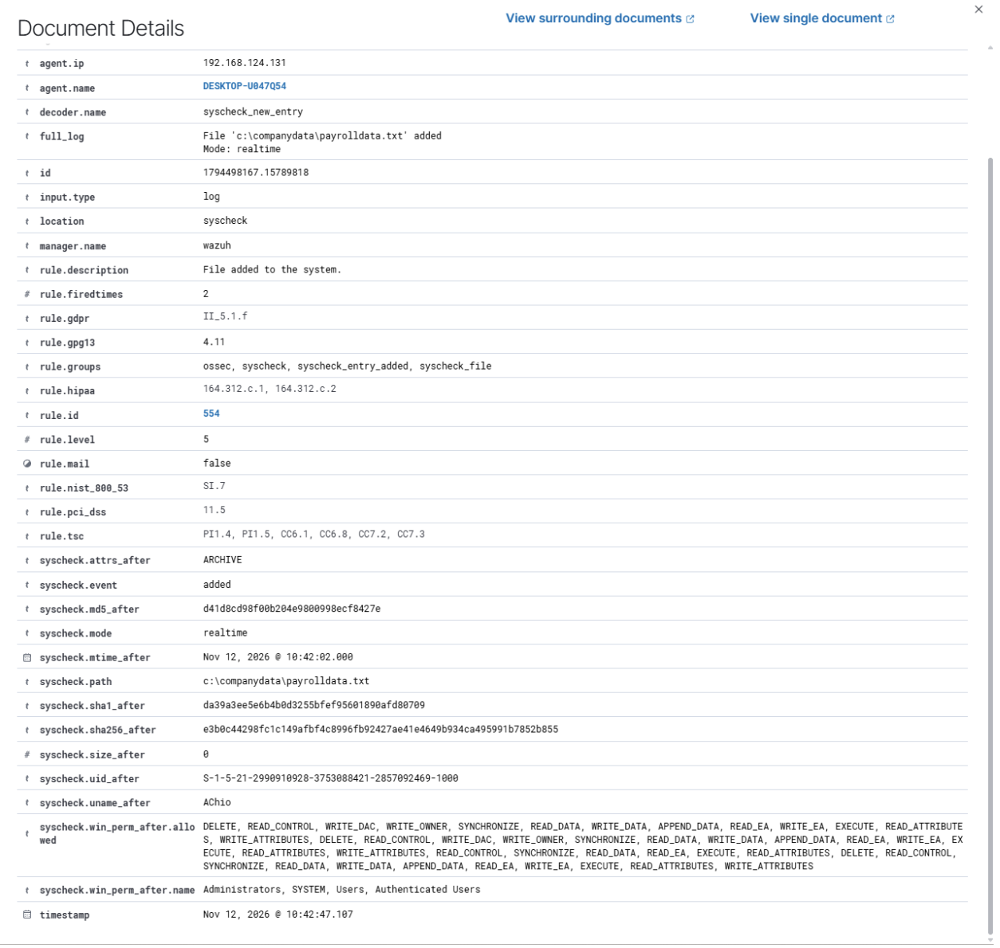
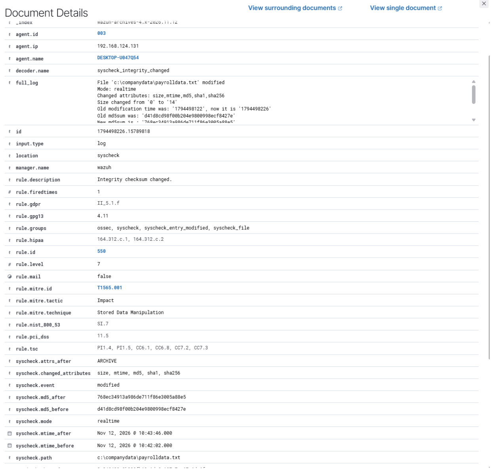

# Incident Investigation Report: IR-001

* **Title:** File Creation and Modification in Monitored Directory (`C:\CompanyData`)
* **Date:** November 12, 2026
* **Target Host:** Windows VM
* **Status:** Closed - Benign Activity


## 1. Executive Summary
On November 12, 2026, Wazuh File Integrity Monitoring (FIM) detected the creation and subsequent modification of a text file (`payrolldata.txt`) inside the monitored `C:\CompanyData` directory on the Windows endpoint. Investigation confirmed the activity was performed by an authorised user (`AChio`) during normal operational hours and posed no threat to the environment.




## 2. Detection Configuration
Real-time File Integrity Monitoring (`syscheck`) was configured in the Windows Wazuh Agent (`ossec.conf`) to monitor `C:\CompanyData`:

```xml
<syscheck>
  <disabled>no</disabled>
  <directories realtime="yes">C:\CompanyData</directories>
</syscheck>
```

## 3. Timeline of Events:
2026-11-12 10:42:47 - c:\companydata\payrolldata.txt was created

2026-11-12 10:43:46 - c:\companydata\payrolldata.txt was edited and saved



## 4. Telemetry & Log Findings:
Rules Triggered:
- 554: Files added to the system (Level 5)
- 550: Integrity checksum changed (Level 7)

User Account: AChio

Target File Path: c:\companydata\payrolldata.txt





## 5. Remediation & Key Learnings:
Resolution: Confirmed that AChio is an authorised user and verified the file modification was a legitimate activity. No containment or rollback actions were required.

Key Learnings:
- Real-time FIM (realtime="yes") immediately captures file creations (Rule 554) and tracks file hash modifications (Rule 550)
- High-sensitivity folders should be paired with a custom rule in local_rules.xml to elevate the alert severity from Level 5 to Level 10+ for faster SOC triage
