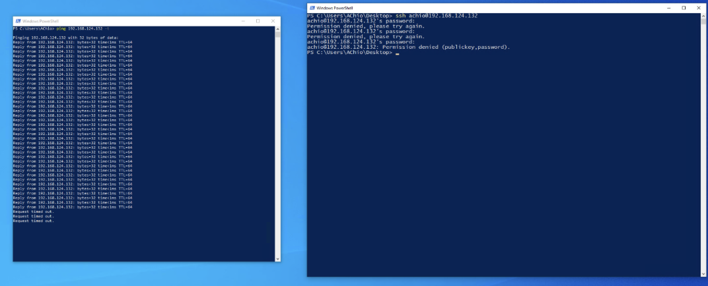
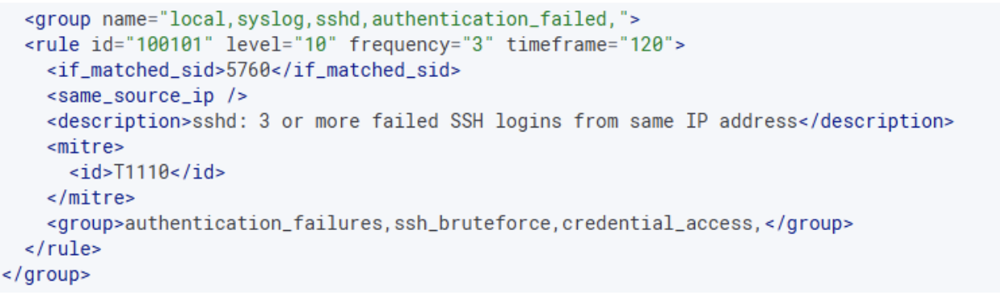
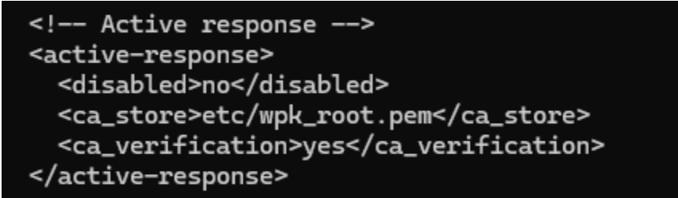
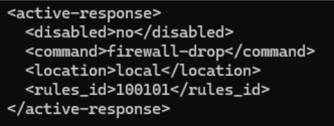
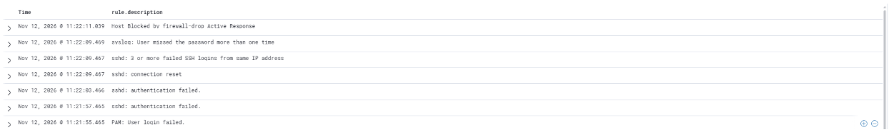
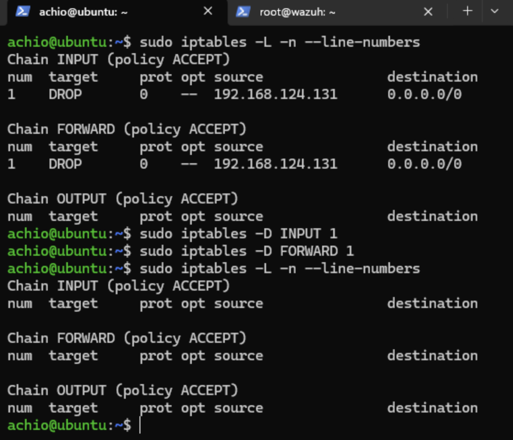

# Incident Investigation Report: IR-003

* **Title:** Repeated Failed SSH Login Attempts & Automated Active Response Block
* **Date:** November 12, 2026
* **Target Host:** Linux VM
* **Source Host:** Windows VM
* **Status:** Closed – Benign Activity

## 1. Executive Summary
On November 12, 2026, Wazuh detected three consecutive failed SSH login attempts targeting the Linux endpoint. Investigation confirmed that the connection attempts originated from the internal Windows VM and were performed by an authorized user (`AChio`) during a controlled lab test. Upon reaching the three-failure threshold, Wazuh Active Response automatically blocked the Windows VM's IP address via the local Linux firewall (`firewall-drop`), verified by continuous ICMP ping requests from the Windows host timing out.

## 2. Detection Configuration
A custom correlation rule (`100101`) was created in `/var/ossec/etc/rules/local_rules.xml` on the Wazuh Manager to monitor built-in Wazuh **Rule `5760`** (*"sshd: authentication failed"*). The rule was configured with `frequency="3"` to trigger when three or more failed SSH login attempts occur from the same source IP address.

Additionally, Wazuh Active Response was enabled on both the Wazuh Manager and the Linux agent, configured to execute the built-in `firewall-drop` command locally on the Linux endpoint whenever Rule `100101` fires.

## 3. Timeline of Events
* **2026-11-12 11:21:55** – `PAM: User login failed` logged on Linux VM.
* **2026-11-12 11:21:57** – `sshd: authentication failed` (Attempt 1).
* **2026-11-12 11:22:03** – `sshd: authentication failed` (Attempt 2).
* **2026-11-12 11:22:09** – `sshd: connection reset` / authentication failure (Attempt 3).
* **2026-11-12 11:22:09** – Custom Rule `100101` triggered: *3 or more failed SSH logins from the same IP address*.
* **2026-11-12 11:22:11** – `Host Blocked by firewall-drop Active Response` executed; continuous ping from Windows VM immediately timed out.

## 4. Telemetry & Log Findings
* **Base Wazuh Rule:** `5760` (`sshd: authentication failed`)
* **Custom Wazuh Rule Triggered:** `100101` (Repeated Failed SSH Login Attempts)
* **Subject / Actor Account:** `AChio`
* **Source Workstation:** `Windows VM`
* **Containment Action:** `firewall-drop` (Active Response)

## 5. Remediation & Key Learnings
* **Resolution:** Confirmed that `AChio` is an authorized administrator and that the failed SSH logins were part of a planned Active Response test. Connectivity between the Windows VM and Linux VM was restored by removing the temporary `DROP` entries from the `INPUT` and `FORWARD` chains in `iptables`.

* **Key Learnings:**
  * **Brute-Force Detection via Correlation:** Individual failed logins (`Rule 5760`) are common background noise, but correlating multiple failures from a single source IP (`frequency="3"`) effectively identifies automated password-guessing or brute-force attempts (MITRE ATT&CK **T1110 – Brute Force**).
  * **Automated Containment:** Pairing correlation rules with Wazuh Active Response (`firewall-drop`) reduces mean time to respond (MTTR) from minutes to seconds by automatically isolating offending IPs at the host firewall level.
  * **Validating Containment:** Running a continuous `ping` from the source host provided immediate network-level verification that `iptables` was actively dropping traffic once the alert fired.
