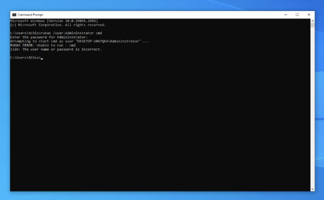
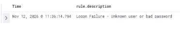
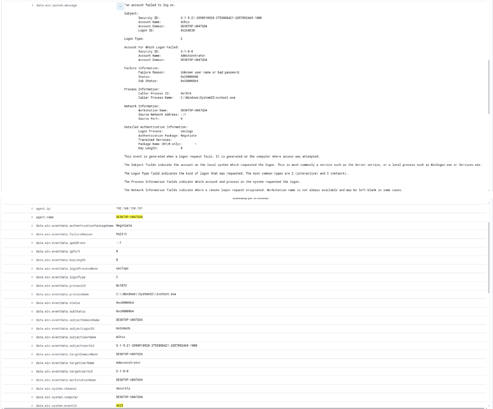

# Incident Investigation Report: IR-004

* **Title:** Failed Local Privilege Escalation Attempt (`runas /user:Administrator`)
* **Date:** November 12, 2026
* **Target Host:** Windows VM
* **Status:** Closed - Benign Activity

## 1. Executive Summary
On November 12, 2026, Wazuh detected a failed Windows authentication attempt targeting the built-in `Administrator` account on the Windows endpoint. Investigation confirmed that user `AChio` executed `runas /user:Administrator cmd` from a standard Command Prompt and entered an incorrect password during a controlled privilege escalation lab test. No unauthorised elevation occurred.



## 2. Detection Configuration
The Windows Wazuh Agent (`ossec.conf`) was configured to forward Windows Security Event Logs via `eventchannel` to the Wazuh Manager, capturing authentication failures (**Event ID `4625`**) which map to Wazuh's built-in Windows authentication rules (`Rule 60122`).

```xml
<localfile>
  <location>Security</location>
  <log_format>eventchannel</log_format>
</localfile>
```

## 3. Timeline of Events
* **2026-11-12 11:36:14** – Windows Security Event ID `4625` logged: *Logon Failure – Unknown user or bad password* 



## 4. Telemetry & Log Findings
* **Windows Event ID:** `4625` (An account failed to log on)
* **Subject / Actor Account:** `AChio`
* **Target Account:** `Administrator`
* **Command Executed:** `runas /user:Administrator cmd`



## 5. Remediation & Key Learnings
* **Resolution:** Confirmed that `AChio` is an authorised administrator performing a controlled privilege escalation simulation. Because the authentication attempt failed (`Event ID 4625`), no unauthorised elevated session was initiated and no account lockout or containment action was required.
* **Key Learnings:**
  * **Tracking Lateral & Vertical Movement:** Monitoring `Event ID 4625` where the `SubjectUserName` (`AChio`) differs from the `TargetUserName` (`Administrator`) helps SOC analysts distinguish normal mistyped passwords from privilege escalation or credential-guessing attempts (MITRE ATT&CK **T1078 – Valid Accounts** / **T1134 – Access Token Manipulation**).
  * **Baseline Visibility:** Even without Sysmon installed, native Windows Security `eventchannel` telemetry provides actionable visibility into local `runas` elevation attempts.
